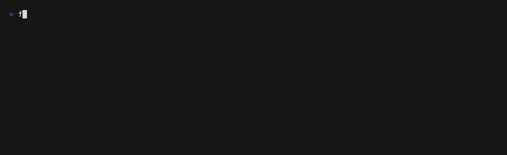
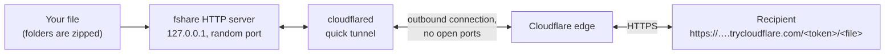

# fshare

**Share a file or folder from your computer through a public download link. One command, no account, no upload.**

[](https://www.npmjs.com/package/@skuljanze95/fshare)
[](https://github.com/skuljanze95/fshare/actions/workflows/ci.yml)
[](https://nodejs.org)
[](package.json)
[](LICENSE)

<!--
  Demo GIF placeholder. Record it with VHS (https://github.com/charmbracelet/vhs):
    vhs docs/demo.tape
  then replace this comment with:
    
-->

```console
$ npx -y @skuljanze95/fshare share ./report.pdf
Starting Cloudflare tunnel ...
✔ Sharing report.pdf (1.2 MB). Anyone with this link can download it:
https://protest-behaviour-attempted-enquiries.trycloudflare.com/2wP0OEeaorLMrQjaD4_MHXLJE2FnfYM7/report.pdf
  Expires    in 1h (2026-10-21 10:10)
  Downloads  unlimited
  Stop       press Ctrl+C, or run: npx @skuljanze95/fshare stop 421379
Download 1 completed (1.2 MB to 203.0.113.7).
```

fshare serves the file **directly from your computer** through a [Cloudflare quick tunnel](https://developers.cloudflare.com/tunnel/get-started/quick-tunnels/). Nothing is uploaded to a storage service. The link stops working when you stop fshare, when it expires (after 1 hour by default), or after a download limit you choose.

It is built for people **and AI agents**: predictable output, a JSON mode, no interactive prompts and meaningful exit codes.

> **Package name:** the npm name `fshare` was already taken, so the package is published as **`@skuljanze95/fshare`**. The command it installs is still called `fshare`.

## Contents

- [Features](#features)
- [Requirements](#requirements)
- [Installation](#installation)
- [Quick start](#quick-start)
- [Usage](#usage)
- [Using with AI agents](#using-with-ai-agents)
- [How it works](#how-it-works)
- [Security notes](#security-notes)
- [Limitations](#limitations)
- [Troubleshooting](#troubleshooting)
- [Uninstall](#uninstall)
- [Contributing](#contributing)
- [License](#license)

## Features

- **One command.** You get a working HTTPS link in about 5 to 10 seconds.
- **No account, no upload.** The file stays on your computer and is streamed to whoever opens the link.
- **Safe defaults.**
  - Every link contains a random 192-bit token and expires after 1 hour.
  - Optional password and download limit.
  - Refuses to share `~/.ssh`, `.env` files, private keys and similar unless you pass `--force`.
- **Folders work.** They are zipped automatically and shared as one `.zip`.
- **Resumable downloads.** HTTP Range requests are supported, so browsers and download managers can resume.
- **Agent-friendly.** `--json`, `--detach`, fixed exit codes and no prompts.
- **Zero dependencies.** You only need Node.js and `cloudflared`.

## Requirements

- **Node.js 18 or newer.** Check with `node --version`; install from [nodejs.org](https://nodejs.org).
- **cloudflared**, Cloudflare's free tunnel client. See [Installation](#installation) below.
- **macOS** (the primary platform), **Linux**, or **Windows** (best-effort).

You do **not** need a Cloudflare account, a domain or any configuration.

## Installation

### 1. Install cloudflared

**macOS** (with [Homebrew](https://brew.sh)):

```bash
brew install cloudflared
```

**Windows** (PowerShell or Command Prompt), then **open a new terminal** so `cloudflared` is on your PATH:

```powershell
winget install --id Cloudflare.cloudflared
```

**Linux, Debian or Ubuntu** (x86_64; on ARM use `cloudflared-linux-arm64.deb`):

```bash
curl -fsSLO https://github.com/cloudflare/cloudflared/releases/latest/download/cloudflared-linux-amd64.deb
sudo dpkg -i cloudflared-linux-amd64.deb
```

**Linux, Fedora, RHEL or openSUSE** (x86_64; on ARM use `cloudflared-linux-aarch64.rpm`):

```bash
curl -fsSLO https://github.com/cloudflare/cloudflared/releases/latest/download/cloudflared-linux-x86_64.rpm
sudo rpm -i cloudflared-linux-x86_64.rpm
```

**Linux, any distribution, without root** (a single binary in `~/.local/bin`, which must be on your PATH):

```bash
mkdir -p ~/.local/bin
curl -fsSL -o ~/.local/bin/cloudflared https://github.com/cloudflare/cloudflared/releases/latest/download/cloudflared-linux-amd64
chmod +x ~/.local/bin/cloudflared
```

Other options (package repositories, Docker, other architectures) are on Cloudflare's [official downloads page](https://developers.cloudflare.com/cloudflare-one/networks/connectors/cloudflare-tunnel/downloads/).

Check that it works:

```bash
cloudflared --version
```

### 2. Run fshare

No installation is needed. Run it with `npx`, which comes with Node.js:

```bash
npx -y @skuljanze95/fshare share ./file.pdf
```

The `-y` skips npx's one-time "Ok to proceed?" question. The same works with other package runners:

```bash
pnpm dlx @skuljanze95/fshare share ./file.pdf
bunx @skuljanze95/fshare share ./file.pdf
```

If you use it often, install it globally and type `fshare`:

```bash
npm i -g @skuljanze95/fshare
fshare share ./file.pdf
```

### 3. Verify your setup

```bash
npx -y @skuljanze95/fshare doctor
```

```text
fshare doctor (v0.1.0)

  PASS  Node.js 22.11.0 (18 or newer required)
  PASS  cloudflared 2026.10.2 (/opt/homebrew/bin/cloudflared)
  PASS  zip (/usr/bin/zip)
  PASS  Network: reached api.trycloudflare.com
  PASS  Network: outbound port 7844 to Cloudflare is open
  PASS  State directory is writable (~/.fshare)
  PASS  Temporary directory is writable

All required checks passed. Try: fshare share ./some-file
```

Anything marked `FAIL` comes with a line explaining how to fix it.

## Quick start

```bash
brew install cloudflared                              # 1. once (see Installation for Linux and Windows)
npx -y @skuljanze95/fshare share ./report.pdf         # 2. prints a link
# 3. send the link to someone, then press Ctrl+C to stop sharing
```

Would you rather keep using your terminal while sharing? Add `--detach`, and stop it later with `fshare stop --all`.

## Usage

The examples below use `fshare`. If you did not install it globally, write `npx -y @skuljanze95/fshare` instead of `fshare`.

| Command                         | What it does                                          |
| ------------------------------- | ----------------------------------------------------- |
| `fshare share <path> [options]` | Share a file or folder and print its download URL     |
| `fshare list`                   | List active shares                                    |
| `fshare status <id>`            | Show details about one share                          |
| `fshare stop <id>` or `--all`   | Stop a share, or all of them                          |
| `fshare doctor`                 | Check that everything is installed and working        |
| `fshare --help`, `--version`    | Show help (also `fshare <command> --help`) or version |

### `fshare share <path>`

Shares **one** file or folder. Folders are zipped first and sent as `<folder-name>.zip`.

| Option                     | Default              | Description                                                                                                                  |
| -------------------------- | -------------------- | ---------------------------------------------------------------------------------------------------------------------------- |
| `--expires <duration>`     | `1h`                 | How long the link works: `30m`, `2h`, `1d`, `1h30m`, `90s` (maximum `30d`).                                                  |
| `--max-downloads <n>`      | unlimited            | Stop sharing after `n` **completed** downloads.                                                                              |
| `--password <password>`    | none                 | Require a password (HTTP Basic Auth; the username is `fshare`). You can also set the `FSHARE_PASSWORD` environment variable. |
| `--name <filename>`        | file/folder name     | Filename the recipient's download is saved as. `.zip` is added for folders.                                                  |
| `--json`                   | off                  | Print one JSON object instead of the URL (see below).                                                                        |
| `--detach`                 | off                  | Keep sharing in the background and return immediately.                                                                       |
| `--keep-awake`             | off                  | Prevent idle sleep while sharing (`caffeinate` on macOS, `systemd-inhibit` on Linux).                                        |
| `--force`                  | off                  | Allow paths that look sensitive (see [Security notes](#security-notes)).                                                     |
| `--protocol <quic\|http2>` | cloudflared's choice | Tunnel protocol. Use `http2` if your network blocks QUIC (UDP).                                                              |

Examples:

```bash
fshare share ./report.pdf                                        # 1 hour, unlimited downloads
fshare share ~/Desktop/photos --expires 2d --name holiday.zip    # a folder, as holiday.zip, for 2 days
fshare share ./contract.pdf --max-downloads 1 --expires 30m      # a single download within 30 minutes
FSHARE_PASSWORD='correct horse' fshare share ./tax-return.pdf    # password protected (username: fshare)
fshare share ./big-video.mp4 --keep-awake --detach               # keep the Mac awake, run in the background
fshare share ./build.tar.gz --json --detach                      # for scripts and AI agents
```

**How long does it run?** Without `--detach`, fshare stays in the foreground until one of these happens:

- you press Ctrl+C
- the link expires
- the download limit is reached
- you run `fshare stop <id>` from another terminal

With `--detach`, it prints the link and returns, while a background process keeps serving the file until it expires, reaches the limit, or you stop it.

**What the recipient sees:** opening the link in a browser downloads the file directly (with a password prompt if you set one). From a terminal:

```bash
curl -fLOJ 'https://…trycloudflare.com/…/report.pdf'                  # saves as report.pdf
curl -fLOJ -u 'fshare:correct horse' 'https://…/tax-return.pdf'       # with a password
wget --content-disposition 'https://…trycloudflare.com/…/report.pdf'
```

**Output.** Only the URL goes to **stdout**; progress and messages go to **stderr**. So `URL=$(fshare share ./x --detach)` just works. With `--json`, stdout gets one JSON object on a single line (formatted here for readability):

```json
{
  "id": "a1b2c3",
  "url": "https://…trycloudflare.com/…/report.pdf",
  "file": "report.pdf",
  "size_bytes": 12345,
  "sha256": "9f86d0…",
  "expires_at": "2026-10-21T12:00:00Z",
  "max_downloads": null,
  "password_protected": false,
  "pid": 4242
}
```

| Field                | Meaning                                                               |
| -------------------- | --------------------------------------------------------------------- |
| `id`                 | Share id, used by `status` and `stop`.                                |
| `url`                | The download link.                                                    |
| `file`               | Download filename (`.zip` for folders).                               |
| `size_bytes`         | Size of the served file.                                              |
| `sha256`             | SHA-256 of the served file, so the recipient can verify the download. |
| `expires_at`         | Expiry time in UTC (ISO 8601).                                        |
| `max_downloads`      | Download limit, or `null` for unlimited.                              |
| `password_protected` | Whether a password is required.                                       |
| `pid`                | Process serving the file.                                             |

If something fails while `--json` is on, stdout gets `{"error":{"code":"…","message":"…","hint":"…","exit_code":N}}` instead.

### `fshare list`

```console
$ fshare list
ID      FILE        DOWNLOADS  EXPIRES  URL
421379  report.pdf  1          in 59m   https://protest-behaviour-attempted-enquiries.trycloudflare.com/2wP0…/report.pdf
```

`DOWNLOADS` shows `count` or `count/limit`. Use `fshare list --json` for a JSON array. Shares whose process has died (for example after a crash or a reboot) are cleaned up automatically.

### `fshare status <id>`

```console
$ fshare status 421379
ID         421379
URL        https://protest-behaviour-attempted-enquiries.trycloudflare.com/2wP0…/report.pdf
File       report.pdf (1.2 MB)
Source     /Users/you/Documents/report.pdf
SHA-256    576976de59e8413bfc9d20089b991421f4ad7b10b0c10c74760bf563a5867355
Created    2026-10-21 09:10 (2s ago)
Expires    2026-10-21 10:10 (in 1h)
Downloads  1 (no limit)
Password   no
Process    pid 27223 (foreground)
```

`fshare status <id> --json` prints the same as JSON.

### `fshare stop <id>` / `fshare stop --all`

```bash
fshare stop 421379
fshare stop --all
fshare stop --all --json     # {"stopped":[{"id":"421379","file":"report.pdf"}]}
```

Stopping closes the tunnel, so the link stops working immediately. It also deletes any temporary zip and removes the share from `fshare list`.

### `fshare doctor`

Checks the Node.js version, cloudflared (and its version), `zip`, network access to Cloudflare (HTTPS and the tunnel port 7844), and that the state and temp directories are writable. `fshare doctor --json` prints the results as JSON.

### Exit codes

| Code | Meaning                                                              |
| ---- | -------------------------------------------------------------------- |
| 0    | Success                                                              |
| 1    | Other error (permissions, unexpected failure)                        |
| 2    | Bad arguments, or a sensitive path refused without `--force`         |
| 3    | File or folder not found, or no active share with that id            |
| 4    | `cloudflared` is not installed or not found                          |
| 5    | The tunnel could not be created, or cloudflared stopped unexpectedly |

### Environment variables

| Variable               | Purpose                                                                                       |
| ---------------------- | --------------------------------------------------------------------------------------------- |
| `FSHARE_PASSWORD`      | Password for `share`, as an alternative to `--password` (keeps it out of your shell history). |
| `FSHARE_HOME`          | State directory (default `~/.fshare`).                                                        |
| `FSHARE_CLOUDFLARED`   | Full path to the `cloudflared` binary, if it is not on your PATH.                             |
| `FSHARE_DEBUG=1`       | Show cloudflared's own log output.                                                            |
| `FSHARE_BUILTIN_ZIP=1` | Zip folders with the built-in ZIP writer instead of the system `zip` command.                 |
| `NO_COLOR`             | Disable colors ([no-color.org](https://no-color.org)).                                        |

### Files fshare creates

- `~/.fshare/shares/<id>.json` holds one file per active share (permissions `0600`). It contains the URL, so treat it as private.
- `~/.fshare/logs/<id>.log` is the log of a `--detach` share. It never contains the secret URL, and logs are deleted after 7 days.
- When you share a folder, a temporary zip is created in your system's temp directory and deleted when the share stops.

## Using with AI agents

fshare gives coding agents a way to hand you files they produced, such as a report, a build or a generated image, as a link. The command an agent should run is:

```bash
npx -y @skuljanze95/fshare share <path> --json --detach --expires 1h
```

- `-y` matters: agents cannot answer npx's "Ok to proceed?" prompt.
- `--detach` returns right away while the link keeps working. Without it, the command would run until the link expires.
- `--json` gives the agent one parseable line containing `url`, `id`, `expires_at` and `sha256`.
- The exit codes tell the agent what went wrong, for example `4` means cloudflared is missing.

**Claude Code.** Install the skill, either for yourself or for one project:

```bash
# for you, in every project
mkdir -p ~/.claude/skills/fshare
curl -fsSL https://raw.githubusercontent.com/skuljanze95/fshare/main/SKILL.md -o ~/.claude/skills/fshare/SKILL.md

# or only for the current project (commit it to share it with your team)
mkdir -p .claude/skills/fshare
curl -fsSL https://raw.githubusercontent.com/skuljanze95/fshare/main/SKILL.md -o .claude/skills/fshare/SKILL.md
```

Then just ask: _"share the report you just generated with me"_.

**Codex, Cursor and other agents that read `AGENTS.md`.** Copy the snippet between `<!-- fshare:start -->` and `<!-- fshare:end -->` from [AGENTS.md](AGENTS.md) into your project's `AGENTS.md`, creating the file if needed. For Codex you can also put it in `~/.codex/AGENTS.md` to enable it everywhere.

**Things to know:**

- The agent needs **network access** and must be allowed to **leave a background process running**. Agents that run commands in a network-less sandbox (for example Codex's default sandbox) need network access approved for this command.
- The instructions tell agents to share only what you asked for, to keep expiry short, and never to use `--force` on secrets without your explicit confirmation.
- fshare itself refuses `~/.ssh`, `.env`, keys and similar paths without `--force`, so a confused agent cannot leak them by accident.

## How it works



1. fshare resolves the path. Folders are zipped to a temporary file, and fshare computes the file's SHA-256.
2. It starts a small HTTP server bound to **127.0.0.1 only**, on a random free port. The server answers exactly one path, `/<random token>/<filename>`; everything else returns `404`, and there is no directory listing.
3. It starts `cloudflared tunnel --url http://127.0.0.1:<port>`. cloudflared opens an **outbound** connection to Cloudflare and receives a random `https://<words>.trycloudflare.com` address, so no router or firewall changes are needed.
4. fshare waits until the link actually works from the internet, and only then prints it.
5. Downloads stream straight from your disk. The file is never loaded into memory, and Range requests let downloads resume.
6. On expiry, when the download limit is reached, or on Ctrl+C or `fshare stop`, fshare closes the server, stops cloudflared, deletes temporary files and removes its state.

## Security notes

**What protects a link:**

- **Unguessable URL.** Each link contains a random 192-bit token. Any other path returns `404`, and token and password checks are constant-time.
- **Expiry by default** (1 hour), plus an optional `--max-downloads` and `--password` (Basic Auth over HTTPS, with repeated wrong passwords throttled).
- **Local only.** The server listens on `127.0.0.1`; the only way in is through the tunnel.
- **Accident prevention.** fshare refuses, unless you pass `--force`, to share:
  - `~/.ssh`, `~/.aws`, `~/.gnupg`, `~/.kube`, `~/.docker`, `~/.config/gcloud`, `~/.config/gh`
  - keychains and `~/Library`
  - `.env` files, `*.pem`/`*.p12`/`*.pfx` keys, `id_rsa` and similar, `.netrc`, `.npmrc`
  - folders containing any of these, or your whole home folder

  Symbolic links inside shared folders are not followed, so a link cannot pull in files from elsewhere.

- **Link previews blocked.** Known chat-app preview bots (Slack, Discord, iMessage, WhatsApp and others) are refused, so they cannot use up a download limit or keep a copy of the file.
- **No leaks in logs.** The tokenized URL is printed only where you asked for it; background log files never contain it. A password passed with `--detach` travels to the background process over a private channel, never on the command line.

**What it does not protect against:**

- **Anyone who has the link can download the file** until it expires. Treat the link like the file itself.
- **Cloudflare can see the traffic.** HTTPS ends at Cloudflare's edge, and the file travels from Cloudflare to your computer through the tunnel.
- **Quick tunnels have no SLA.** They are intended for testing and development.

Read [SECURITY.md](SECURITY.md) for the full threat model and how to report a vulnerability.

## Limitations

- **Your computer must stay on, awake and online** while the link is used. Closing a laptop lid usually puts it to sleep, even with `--keep-awake`, which only prevents _idle_ sleep.
- **Speed is limited by your upload bandwidth.** Large files take as long as your connection needs to upload them.
- **Quick tunnels have no uptime guarantee.** They can be rate-limited, each one handles at most 200 requests at the same time, and the URL is different every time.
- **Cloudflare's terms apply.** Using Cloudflare to serve large amounts of video or other large media files may conflict with Cloudflare's [service terms](https://www.cloudflare.com/service-specific-terms-application-services/). Use a dedicated service for heavy or recurring transfers.
- **One file per link.** Folders are zipped, which needs temporary disk space about the size of the folder.
- **Don't change the file while it is shared.** If it changes, the link answers `410 Gone` so nobody gets a half-old, half-new file; share it again instead.
- **Windows is best-effort.** `--keep-awake` is not available there, and `stop` ends the background process abruptly (cleanup still happens).

## Troubleshooting

Start with `npx -y @skuljanze95/fshare doctor`. It checks most of the problems below for you.

| Problem                                                                  | What to do                                                                                                                                                                                                                      |
| ------------------------------------------------------------------------ | ------------------------------------------------------------------------------------------------------------------------------------------------------------------------------------------------------------------------------- |
| **`cloudflared is not installed`** (exit code 4)                         | Install it (see [Installation](#installation)), then open a new terminal. If it is installed somewhere unusual, set `FSHARE_CLOUDFLARED=/full/path/to/cloudflared`.                                                             |
| **`Timed out … waiting for cloudflared`** (exit code 5)                  | Check your internet connection. Try `--protocol http2`; many networks block QUIC (UDP port 7844). VPNs, proxies and corporate firewalls can block tunnels; try another network.                                                 |
| **Firewall blocks QUIC / UDP**                                           | Use `--protocol http2`, which uses TCP port 7844. If `doctor` says port 7844 is blocked, ask your network admin or use another network.                                                                                         |
| **`429` / rate limited**                                                 | Cloudflare limits how often one network can create quick tunnels. Wait a few minutes.                                                                                                                                           |
| **The link shows a Cloudflare error (1033 / 530) or "can't be reached"** | The share was stopped or expired (check `fshare list`), or your computer is asleep or offline. Right after creation, give it a few seconds.                                                                                     |
| **`404 Not Found`**                                                      | The URL was cut off or changed. Chat apps sometimes truncate long links or add punctuation, so copy the whole link exactly.                                                                                                     |
| **`410 Gone`**                                                           | The link expired, reached its download limit, or the file changed after sharing. Share it again.                                                                                                                                |
| **`401` / password prompt**                                              | The username is `fshare`; the password is the one passed with `--password` (or `FSHARE_PASSWORD`).                                                                                                                              |
| **Port already in use**                                                  | fshare never uses a fixed port: it picks a free one each time, so just retry. cloudflared also opens a local metrics port (20241–20245); a conflict there is harmless.                                                          |
| **The link stopped working while I was away**                            | Your computer probably went to sleep. Use `--keep-awake`, keep the lid open and the charger connected. On macOS you can also enable _System Settings → Battery → Options → Prevent automatic sleeping when the display is off_. |
| **`npx` runs an old version or behaves oddly**                           | Run `npx -y @skuljanze95/fshare@latest …`, or clear npx's cache: `rm -rf ~/.npm/_npx` (Windows: delete `%LocalAppData%\npm-cache\_npx`).                                                                                        |
| **`Refusing to share … because …`** (exit code 2)                        | That path looks like it contains secrets. If you are sure, add `--force`.                                                                                                                                                       |
| **The download count doesn't go up**                                     | Only _completed_ downloads count. Previews, `HEAD` requests and interrupted downloads don't.                                                                                                                                    |
| **Quick tunnels fail and you also use named Cloudflare tunnels**         | A `config.yml` in `~/.cloudflared/` can interfere with quick tunnels. Rename it temporarily and try again.                                                                                                                      |
| **I need more details**                                                  | Run with `FSHARE_DEBUG=1` to see cloudflared's logs. Background shares log to `~/.fshare/logs/<id>.log`.                                                                                                                        |

Still stuck? [Open an issue](https://github.com/skuljanze95/fshare/issues/new/choose) and include the output of `fshare doctor`. Remove any share URLs first, since they contain secret tokens.

## Uninstall

```bash
fshare stop --all                 # or: npx -y @skuljanze95/fshare stop --all
npm rm -g @skuljanze95/fshare     # only if you installed it globally
rm -rf ~/.fshare                  # state and logs
rm -rf ~/.npm/_npx                # optional: clear npx's cache
brew uninstall cloudflared        # optional (Windows: winget uninstall Cloudflare.cloudflared)
```

## Contributing

Contributions are welcome! [CONTRIBUTING.md](CONTRIBUTING.md) explains the development setup (`npm ci`, `npm test`, `npm run lint`), how the code is organized and the pull request checklist. Please also read the [Code of Conduct](CODE_OF_CONDUCT.md).

## License

[MIT](LICENSE) © Anže Škulj
